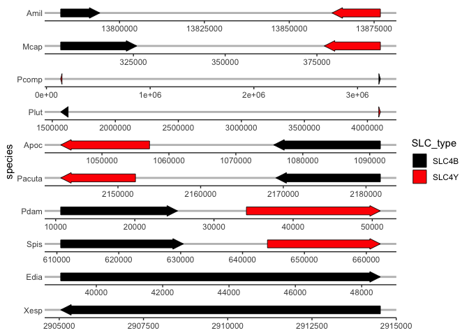
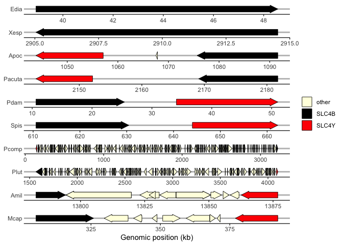
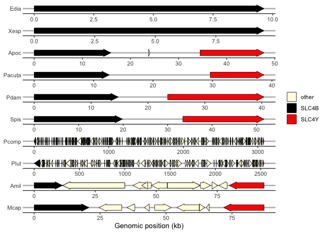
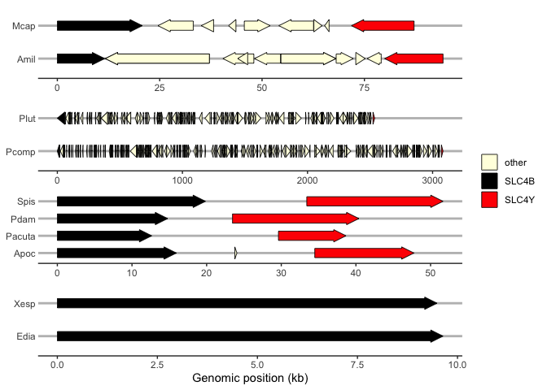
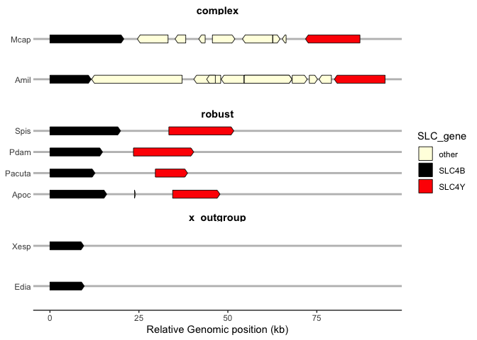
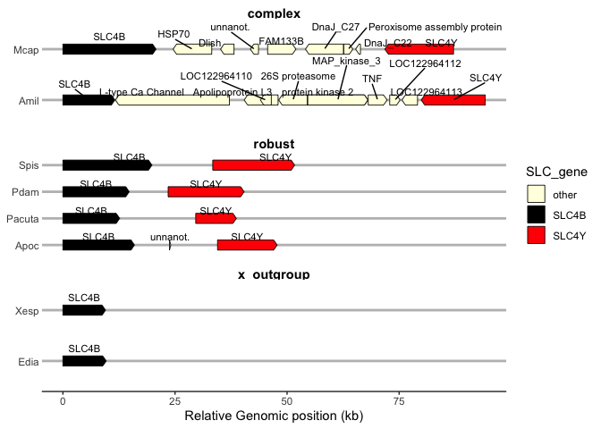
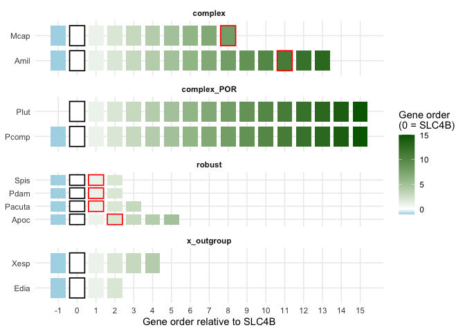
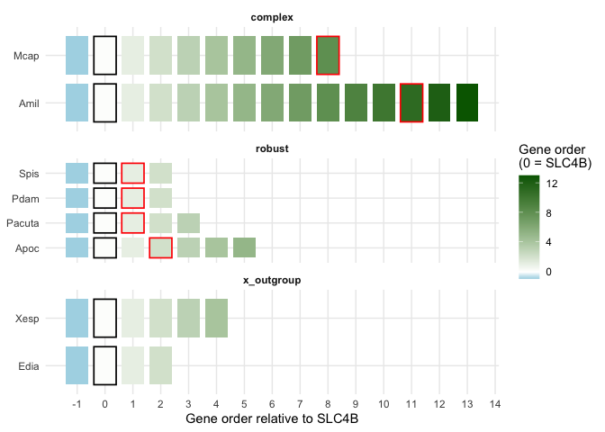
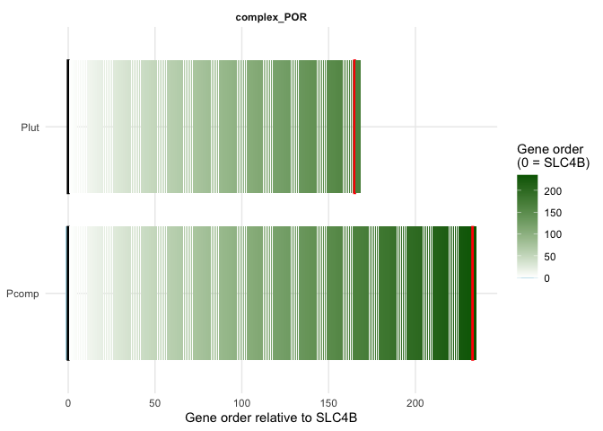
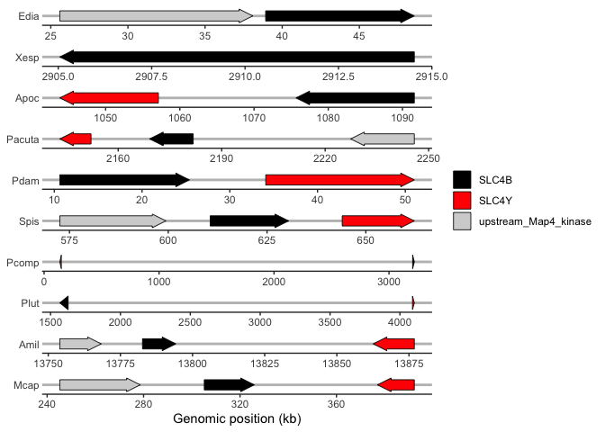

SLC
================
Zoe Dellaert
2026-11-18

## Load packages

``` r
library(tidyverse)
```

    ## Warning: package 'ggplot2' was built under R version 4.5.2

    ## Warning: package 'readr' was built under R version 4.5.2

    ## Warning: package 'purrr' was built under R version 4.5.2

    ## Warning: package 'dplyr' was built under R version 4.5.2

    ## ── Attaching core tidyverse packages ──────────────────────── tidyverse 2.0.0 ──
    ## ✔ dplyr     1.2.1     ✔ readr     2.2.0
    ## ✔ forcats   1.0.1     ✔ stringr   1.6.0
    ## ✔ ggplot2   4.0.3     ✔ tibble    3.3.1
    ## ✔ lubridate 1.9.5     ✔ tidyr     1.3.2
    ## ✔ purrr     1.2.2     
    ## ── Conflicts ────────────────────────────────────────── tidyverse_conflicts() ──
    ## ✖ dplyr::filter() masks stats::filter()
    ## ✖ dplyr::lag()    masks stats::lag()
    ## ℹ Use the conflicted package (<http://conflicted.r-lib.org/>) to force all conflicts to become errors

``` r
library(gggenes)
```

    ## Warning: package 'gggenes' was built under R version 4.5.2

## Step 0

Define species and clades

``` r
species_key <- tribble(
  ~species, ~full_name,       ~genus,   ~clade,
  "Amil", "Acropora_millepora", "Acropora", "complex",
  "Mcap", "Montipora_capitata", "Montipora", "complex",
  "Pcomp", "Porites_compressa", "Porites", "complex_POR",
  "Plut", "Porites_lutea", "Porites", "complex_POR",
  "Pacuta", "Pocillopora_acuta", "Pocillopora", "robust",
  "Pdam",  "Pocillopora_damicornis", "Pocillopora", "robust",
  "Spis",  "Stylophora_pistillata", "Stylophora", "robust",
  "Apoc",  "Astrangia_poculata", "Astrangia", "robust",
  "Edia", "Exaiptasia_palladia", "Exaiptasia", "x_outgroup",
  "Xesp",  "Xenia_sp", "Xenia", "x_outgroup"
) 

species_key <- species_key %>% arrange(desc(clade), species) %>%
  mutate(across(clade, fct_inorder), across(species, fct_inorder))

SLC_colors <- c("SLC4B" = "black", "SLC4Y" = "red", "other"="lightyellow")
```

## Step 1. Load in results from ortholog analyses

``` r
broc_pairs <- data.table::fread("../references/cnidarian_orthologs/broccoli/dir_step4/orthologous_pairs.txt", header=F)
colnames(broc_pairs) <- c("Gene_spA","Gene_spB")

broc_groups <- data.table::fread("../references/cnidarian_orthologs/broccoli/dir_step3/table_OGs_protein_names.txt", header=T)
```

### Download GTFs: many have already been downloaded but code is copied again below as reference:

``` bash
cd references

# Pocillopora_acuta
# Porites_compressa
# Montipora_capitata

wget http://cyanophora.rutgers.edu/Pocillopora_acuta/Pocillopora_acuta_HIv2.genes.gff3.gz
wget http://cyanophora.rutgers.edu/montipora/Montipora_capitata_HIv3.genes.gff3.gz
wget http://cyanophora.rutgers.edu/porites_compressa/Porites_compressa_HIv1.genes.gff3.gz

cd cnidarian_marker_genes/cnidarian_sc_marker_lists/annotation_files

# Exaiptasia_diaphana
wget http://aiptasia.reefgenomics.org/download/aiptasia_genome.gff3.gz

# Nematostella_vectensis

# Astrangia_poculata
wget https://zenodo.org/records/14110456/files/apoculata.gtf.gz?download=1

# Orbicella_faveolata
# Pocillopora_damicornis
wget https://ftp.ncbi.nlm.nih.gov/genomes/all/GCF/003/704/095/GCF_003704095.1_ASM370409v1/GCF_003704095.1_ASM370409v1_genomic.gtf.gz

# Stylophora_pistillata
wget https://ftp.ncbi.nlm.nih.gov/genomes/all/GCF/002/571/385/GCF_002571385.2_Stylophora_pistillata_v1.1/GCF_002571385.2_Stylophora_pistillata_v1.1_genomic.gtf.gz

# Xenia_sp
wget https://cmo.carnegiescience.edu/endosymbiosis/genome/xenSp1.gtf
wget https://cmo.carnegiescience.edu/endosymbiosis/data/id2symbol.txt

# Acropora_millepora
wget https://ftp.ncbi.nlm.nih.gov/genomes/all/GCF/013/753/865/GCF_013753865.1_Amil_v2.1/GCF_013753865.1_Amil_v2.1_genomic.gtf.gz

## Species without single cell data, but good genomes incl. in my ortholog analysis
wget https://ftp.ncbi.nlm.nih.gov/genomes/all/GCF/958/299/795/GCF_958299795.1_jaPorLute2.1/GCF_958299795.1_jaPorLute2.1_genomic.gtf.gz

gunzip *gz
mv aiptasia_genome.gff3 01-Edia_annot.gff3
mv apoculata.gtf 05-Apoc_annot.gtf
mv GCF_003704095.1_ASM370409v1_genomic.gtf  07-Pdam_annot.gtf
mv GCF_002571385.2_Stylophora_pistillata_v1.1_genomic.gtf 08-Spis_annot.gtf
mv xenSp1.gtf 09-Xesp_annot.gtf
mv id2symbol.txt 09-Xesp_annot.txt
mv GCF_013753865.1_Amil_v2.1_genomic.gtf    10-Amil_annot.gtf

mv GCF_958299795.1_jaPorLute2.1_genomic.gtf jaPorLute2.1.gtf
```

#### Process GTFs into format for plotting genes

``` r
Pcomp_SwissP <- read.delim("../annotation/Porites_compressa_HIv1_Swissprot_GO.tsv")
Mcap_SwissP <- read.delim("../annotation/Montipora_capitata_HIv3_Swissprot_GO.tsv")
Pacuta_SwissP <- read.delim("../annotation/Pocillopora_acuta_HIv2_Swissprot_GO.tsv")
  
Pacu_gff <- rtracklayer::import("../references/Pocillopora_acuta_HIv2.genes.gff3")
Pacu_annot <- as.data.frame(Pacu_gff) %>%
                        filter(type == "transcript") %>% 
                        select(seqnames, start, end, strand, ID) %>% 
                        distinct() %>% mutate(species = "Pacuta") %>%
  left_join(Pacuta_SwissP %>% select(query,ProteinNames), by = join_by(ID==query))

Pcom_gff <- rtracklayer::import("../references/Porites_compressa_HIv1.genes.gff3")
Pcom_annot <- as.data.frame(Pcom_gff) %>%
                        filter(type == "transcript") %>% 
                        select(seqnames, start, end, strand, ID) %>% 
                        distinct() %>% mutate(species = "Pcomp") %>%
  left_join(Pcomp_SwissP %>% select(query,ProteinNames), by = join_by(ID==query))


Mcap_gff <- rtracklayer::import("../references/Montipora_capitata_HIv3.genes.gff3")
Mcap_annot <- as.data.frame(Mcap_gff) %>%
                        filter(type == "transcript") %>% 
                        select(seqnames, start, end, strand, ID) %>% 
                        distinct() %>% mutate(species = "Mcap") %>%
  left_join(Mcap_SwissP %>% select(query,ProteinNames), by = join_by(ID==query))
```

``` r
Amil_gtf <- rtracklayer::import("../references/cnidarian_marker_genes/cnidarian_sc_marker_lists/annotation_files/10-Amil_annot.gtf")
# choose widest transcript only, since all are annotating the same protein
Amil_transcripts_max <- as.data.frame(Amil_gtf) %>%
                        filter(type=="transcript") %>% 
                        group_by(gene_id) %>% slice_max(width) %>% pull(transcript_id)
# use those to pull the protein IDs, which are not on the same line as the transcript ids                      
Amil_prot <- as.data.frame(Amil_gtf) %>%
                        filter(type == "CDS") %>% filter(transcript_id %in% Amil_transcripts_max) %>% 
                        select(gene_id, protein_id, product) %>% 
                        distinct()

Amil_annot <- as.data.frame(Amil_gtf) %>%
                        filter(gene_biotype=="protein_coding") %>% 
                        select(seqnames, start, end, strand, gene_id) %>% 
                        distinct() %>% left_join(Amil_prot) %>% rename(ID=protein_id) %>% select(-gene_id) %>% 
  mutate(species = "Amil") %>% rename(ProteinNames=product)
```

    ## Joining with `by = join_by(gene_id)`

``` r
# example gene name prefixes
unique(stringr::str_sub(Amil_annot$ID,1,6))
```

    ## [1] "XP_029" "XP_044" NA

``` r
Plut_gtf <- rtracklayer::import("../references/cnidarian_marker_genes/cnidarian_sc_marker_lists/annotation_files/jaPorLute2.1.gtf")
# choose widest transcript only, since all are annotating the same protein
Plut_transcripts_max <- as.data.frame(Plut_gtf) %>%
                        filter(type=="transcript") %>% 
                        group_by(gene_id) %>% slice_max(width) %>% pull(transcript_id)
# use those to pull the protein IDs, which are not on the same line as the transcript ids                      
Plut_prot <- as.data.frame(Plut_gtf) %>%
                        filter(type == "CDS") %>% filter(transcript_id %in% Plut_transcripts_max) %>% 
                        select(gene_id, protein_id, product) %>% 
                        distinct()

Plut_annot <- as.data.frame(Plut_gtf) %>%
                        filter(gene_biotype=="protein_coding") %>% 
                        select(seqnames, start, end, strand, gene_id) %>% 
                        distinct() %>% left_join(Plut_prot) %>% rename(ID=protein_id) %>% select(-gene_id) %>% 
  mutate(species = "Plut") %>% rename(ProteinNames=product)
```

    ## Joining with `by = join_by(gene_id)`

``` r
# example gene name prefixes
unique(stringr::str_sub(Plut_annot$ID,1,6))
```

    ## [1] "XP_073" NA

``` r
Pdam_gtf <- rtracklayer::import("../references/cnidarian_marker_genes/cnidarian_sc_marker_lists/annotation_files/07-Pdam_annot.gtf")

# choose widest transcript only, since all are annotating the same protein
Pdam_transcripts_max <- as.data.frame(Pdam_gtf) %>%
                        filter(type=="transcript") %>% 
                        group_by(gene_id) %>% slice_max(width) %>% pull(transcript_id)
# use those to pull the protein IDs, which are not on the same line as the transcript ids                      
Pdam_prot <- as.data.frame(Pdam_gtf) %>%
                        filter(type == "CDS") %>% filter(transcript_id %in% Pdam_transcripts_max) %>% 
                        select(gene_id, protein_id, product) %>% 
                        distinct()

Pdam_annot <- as.data.frame(Pdam_gtf) %>%
                        filter(gene_biotype=="protein_coding") %>% 
                        select(seqnames, start, end, strand, gene_id) %>% 
                        distinct() %>% left_join(Pdam_prot) %>% rename(ID=protein_id) %>% select(-gene_id) %>% 
  mutate(species = "Pdam") %>% rename(ProteinNames=product)
```

    ## Joining with `by = join_by(gene_id)`

``` r
# example gene name prefixes
unique(stringr::str_sub(Pdam_annot$ID,1,6))
```

    ## [1] "XP_027" NA       "YP_001"

``` r
Spis_gtf <- rtracklayer::import("../references/cnidarian_marker_genes/cnidarian_sc_marker_lists/annotation_files/08-Spis_annot.gtf")
# choose widest transcript only, since all are annotating the same protein
Spis_transcripts_max <- as.data.frame(Spis_gtf) %>%
                        filter(type=="transcript") %>% 
                        group_by(gene_id) %>% slice_max(width) %>% pull(transcript_id)
# use those to pull the protein IDs, which are not on the same line as the transcript ids                      
Spis_prot <- as.data.frame(Spis_gtf) %>%
                        filter(type == "CDS") %>% filter(transcript_id %in% Spis_transcripts_max) %>% 
                        select(gene_id, protein_id, product) %>% 
                        distinct()

Spis_annot <- as.data.frame(Spis_gtf) %>%
                        filter(gene_biotype=="protein_coding") %>% 
                        select(seqnames, start, end, strand, gene_id) %>% 
                        distinct() %>% left_join(Spis_prot) %>% rename(ID=protein_id) %>% select(-gene_id) %>% 
  mutate(species = "Spis") %>% rename(ProteinNames=product)
```

    ## Joining with `by = join_by(gene_id)`

``` r
# example gene name prefixes
unique(stringr::str_sub(Spis_annot$ID,1,6))
```

    ## [1] "XP_022" NA       "YP_002"

``` r
Apoc_gtf <- rtracklayer::import("../references/cnidarian_marker_genes/cnidarian_sc_marker_lists/annotation_files/05-Apoc_annot.gtf")

# choose widest transcript only, since all are annotating the same protein
Apoc_annot <- as.data.frame(Apoc_gtf) %>%
  filter(!grepl("_tRNA",transcript_id)) %>%
                        filter(type=="transcript") %>%  distinct() %>%
                        group_by(transcript_id) %>% slice_max(width) %>%  distinct() %>%  ungroup() %>%
  mutate(ID = paste0("protein|",transcript_id))  %>%
  select(seqnames, start, end, strand, ID)  %>%
  mutate(species = "Apoc", ProteinNames = NA)

# example gene name prefixes
unique(stringr::str_sub(Apoc_annot$ID,1,12))
```

    ## [1] "protein|evm."

``` r
Xesp_gtf <- rtracklayer::import("../references/cnidarian_marker_genes/cnidarian_sc_marker_lists/annotation_files/09-Xesp_annot.gtf")

Xesp_transcripts <- as.data.frame(Xesp_gtf) %>%
                        filter(type == "CDS") %>% 
  group_by(transcript_id) %>%
  mutate(start_full = min(start), end_full = max(end)) %>%
  select(-c(start,end, width,phase)) %>% distinct() %>% rename(start=start_full,
                                                               end = end_full)

 Xesp_annot <- Xesp_transcripts %>% 
                        select(seqnames, start, end, strand, transcript_id,gene_name) %>% 
                        distinct() %>% rename(ID=transcript_id) %>%
  mutate(species = "Xesp") %>% rename(ProteinNames=gene_name)

# example gene name prefixes
unique(stringr::str_sub(Xesp_annot$ID,1,4))
```

    ## [1] "Xe_0"

``` r
Edia_gff <- rtracklayer::import("../references/cnidarian_marker_genes/cnidarian_sc_marker_lists/annotation_files/01-Edia_annot.gff3")

# choose widest transcript only, since all are annotating the same protein
Edia_annot <- as.data.frame(Edia_gff) %>%
                        filter(type=="mRNA") %>%  distinct() %>%
                        group_by(ID) %>% slice_max(width) %>%  distinct() %>% 
  select(seqnames, start, end, strand, ID)  %>%
  mutate(species = "Edia", ProteinNames = NA)

# example gene name prefixes
unique(stringr::str_sub(Edia_annot$ID,1,4))
```

    ## [1] "AIPG"

``` r
gff_list <- list(Pacuta = Pacu_annot,
                  Pcomp = Pcom_annot,
                  Mcap = Mcap_annot,
                  Amil = Amil_annot,
                 Plut = Plut_annot,
                 Pdam = Pdam_annot,
                 Apoc=Apoc_annot,
                 Spis = Spis_annot,
                 Xesp =  Xesp_annot,
                 Edia = Edia_annot)

gff_all <- do.call(rbind,gff_list)

gff_all <- gff_all %>% mutate(forward = case_when(
      strand == "+" ~ TRUE, strand == "-" ~ FALSE,
    ))

# remove all the large gff and gtf objects 
rm(list = ls(pattern = "_gtf$"))
rm(list = ls(pattern = "_gff$"))
```

## Step 2: Identify SLC4 B + Y Orthologs

> XP_029206541.1 anion exchange protein 2-like \[Acropora millepora
> SLC4Y\] XP_029206496.2 band 3 anion transport protein-like \[Acropora
> millepora SLC4B\]

``` r
Amil_SLC4B <- "XP_029206496.2"
Amil_SLC4Y <- "XP_029206541.1"

SLC4B_broc <- c(broc_pairs %>% filter(grepl(Amil_SLC4B,Gene_spA)) %>% pull(Gene_spB),
                broc_pairs %>% filter(grepl(Amil_SLC4B,Gene_spB)) %>% pull(Gene_spA),
                Amil_SLC4B)

SLC4Y_broc <- c(broc_pairs %>% filter(grepl(Amil_SLC4Y,Gene_spA)) %>% pull(Gene_spB),
                broc_pairs %>% filter(grepl(Amil_SLC4Y,Gene_spB)) %>% pull(Gene_spA),
                Amil_SLC4Y)

SLC4B_broc_group <- broc_groups %>% filter(grepl(Amil_SLC4B,Amil_proteins.faa))
SLC4Y_broc_group <- broc_groups %>% filter(grepl(Amil_SLC4Y,Amil_proteins.faa))
print(t(SLC4B_broc_group))
```

    ##                      [,1]                                                                                                                                                
    ## #OG_name             "OG_15787"                                                                                                                                          
    ## Acer_proteins.faa    "ENSLGJP00010037021.1 ENSLGJP00010037034.1 ENSLGJP00010037039.1 ENSLGJP00010037047.1 ENSLGJP00010037051.1 ENSLGJP00010038608.1 ENSLGJP00010038617.1"
    ## Ahya_proteins.faa    "ENSATYP00010027930.1 ENSATYP00010027936.1 ENSATYP00010029228.1"                                                                                    
    ## Amil_proteins.faa    "XP_029206496.2 XP_029206541.1 XP_029206545.1 XP_029206546.1"                                                                                       
    ## Amur_proteins.faa    "XP_067019178.1 XP_067019179.1 XP_067019180.1 XP_067019838.1"                                                                                       
    ## Apoc_proteins.faa    "protein|evm.model.Ap11.79 protein|evm.model.Ap11.81"                                                                                               
    ## Edia_proteins.faa    "AIPGENE21648"                                                                                                                                      
    ## Hsym_proteins.faa    "XP_057305087.1 XP_057305088.1"                                                                                                                     
    ## Hvul_proteins.faa    "Sc4wPfr_301.g13988.t1 Sc4wPfr_301.g13990.t1"                                                                                                       
    ## McapASG_proteins.faa "ENSOPAP00000025196.1 ENSOPAP00000030688.1"                                                                                                         
    ## Mcap_proteins.faa    "Montipora_capitata_HIv3___RNAseq.g44456.t1 Montipora_capitata_HIv3___RNAseq.20936_t"                                                               
    ## Nvec_proteins.faa    "NV2t011174001.1"                                                                                                                                   
    ## Ofav_proteins.faa    "QW917_034175-T1 QW917_034176-T1"                                                                                                                   
    ## Pacu_proteins.faa    "Pocillopora_acuta_HIv2___TS.g27873.t1 Pocillopora_acuta_HIv2___RNAseq.g15280.t1"                                                                   
    ## Pcom_proteins.faa    "Porites_compressa_HIv1___RNAseq.g31477.t1 Porites_compressa_HIv1___RNAseq.g31687.t1"                                                               
    ## PdamASG_proteins.faa "XP_027035732.2 XP_027035733.2 XP_089049830.1 XP_089049831.1 XP_089049832.1"                                                                        
    ## Pdam_RG_proteins.faa "pdam_00022877-RA pdam_00022876-RA"                                                                                                                 
    ## Pdam_proteins.faa    "XP_027035732.1 XP_027035733.1"                                                                                                                     
    ## Plob_proteins.faa    "ENSNQRP00000018228.1 ENSNQRP00000018238.1 ENSNQRP00000020142.1 ENSNQRP00000020146.1 ENSNQRP00000020155.1 ENSNQRP00000032552.1 ENSNQRP00000032558.1"
    ## Plut_proteins.faa    "ENSXVXP00000019077.1 ENSXVXP00000019082.1 ENSXVXP00000019091.1 ENSXVXP00000021256.1"                                                               
    ## Spis_proteins.faa    "XP_022788270.1 XP_022788307.1 XP_022788308.1 XP_022788309.1 XP_022788310.1 XP_022788311.1"                                                         
    ## Xesp_proteins.faa    "Xe_021526-T1"

``` r
print(t(SLC4Y_broc_group))
```

    ##                      [,1]                                                                                                                                                
    ## #OG_name             "OG_15787"                                                                                                                                          
    ## Acer_proteins.faa    "ENSLGJP00010037021.1 ENSLGJP00010037034.1 ENSLGJP00010037039.1 ENSLGJP00010037047.1 ENSLGJP00010037051.1 ENSLGJP00010038608.1 ENSLGJP00010038617.1"
    ## Ahya_proteins.faa    "ENSATYP00010027930.1 ENSATYP00010027936.1 ENSATYP00010029228.1"                                                                                    
    ## Amil_proteins.faa    "XP_029206496.2 XP_029206541.1 XP_029206545.1 XP_029206546.1"                                                                                       
    ## Amur_proteins.faa    "XP_067019178.1 XP_067019179.1 XP_067019180.1 XP_067019838.1"                                                                                       
    ## Apoc_proteins.faa    "protein|evm.model.Ap11.79 protein|evm.model.Ap11.81"                                                                                               
    ## Edia_proteins.faa    "AIPGENE21648"                                                                                                                                      
    ## Hsym_proteins.faa    "XP_057305087.1 XP_057305088.1"                                                                                                                     
    ## Hvul_proteins.faa    "Sc4wPfr_301.g13988.t1 Sc4wPfr_301.g13990.t1"                                                                                                       
    ## McapASG_proteins.faa "ENSOPAP00000025196.1 ENSOPAP00000030688.1"                                                                                                         
    ## Mcap_proteins.faa    "Montipora_capitata_HIv3___RNAseq.g44456.t1 Montipora_capitata_HIv3___RNAseq.20936_t"                                                               
    ## Nvec_proteins.faa    "NV2t011174001.1"                                                                                                                                   
    ## Ofav_proteins.faa    "QW917_034175-T1 QW917_034176-T1"                                                                                                                   
    ## Pacu_proteins.faa    "Pocillopora_acuta_HIv2___TS.g27873.t1 Pocillopora_acuta_HIv2___RNAseq.g15280.t1"                                                                   
    ## Pcom_proteins.faa    "Porites_compressa_HIv1___RNAseq.g31477.t1 Porites_compressa_HIv1___RNAseq.g31687.t1"                                                               
    ## PdamASG_proteins.faa "XP_027035732.2 XP_027035733.2 XP_089049830.1 XP_089049831.1 XP_089049832.1"                                                                        
    ## Pdam_RG_proteins.faa "pdam_00022877-RA pdam_00022876-RA"                                                                                                                 
    ## Pdam_proteins.faa    "XP_027035732.1 XP_027035733.1"                                                                                                                     
    ## Plob_proteins.faa    "ENSNQRP00000018228.1 ENSNQRP00000018238.1 ENSNQRP00000020142.1 ENSNQRP00000020146.1 ENSNQRP00000020155.1 ENSNQRP00000032552.1 ENSNQRP00000032558.1"
    ## Plut_proteins.faa    "ENSXVXP00000019077.1 ENSXVXP00000019082.1 ENSXVXP00000019091.1 ENSXVXP00000021256.1"                                                               
    ## Spis_proteins.faa    "XP_022788270.1 XP_022788307.1 XP_022788308.1 XP_022788309.1 XP_022788310.1 XP_022788311.1"                                                         
    ## Xesp_proteins.faa    "Xe_021526-T1"

``` r
rm(broc_pairs)
```

``` r
SLC4B_broc_sel <- as.data.frame(SLC4B_broc) %>%
  # find rows that contain genes from our three species and label them with a new species column
  mutate(
    species = case_when(
      grepl(Amil_SLC4B, SLC4B_broc) ~ "Amil",
      grepl("Pocillopora_acuta", SLC4B_broc) ~ "Pacuta",
      grepl("Montipora_capitata", SLC4B_broc) ~ "Mcap",
      grepl("Porites_compressa", SLC4B_broc) ~ "Pcomp",
      grepl("ENSXVXP", SLC4B_broc) ~ "Plut",
      grepl("XP_027|YP_001", SLC4B_broc) ~ "Pdam",
      grepl("XP_022|YP_002", SLC4B_broc) ~ "Spis",
      grepl("protein|evm.", SLC4B_broc) ~ "Apoc",
      grepl("Xe_0", SLC4B_broc) ~ "Xesp",
      grepl("AIPGENE", SLC4B_broc) ~ "Edia"
    )
  ) %>%
  # remove rows that don't contain genes from our three species
  filter(!is.na(species)) %>%
  select(SLC4B_broc, species) %>% mutate(SLC_type = "SLC4B") %>% rename(SLC4_gene=SLC4B_broc)

SLC4Y_broc_sel <- as.data.frame(SLC4Y_broc) %>%
  # find rows that contain genes from our three species and label them with a new species column
  mutate(
    species = case_when(
      grepl(Amil_SLC4Y, SLC4Y_broc) ~ "Amil",
      grepl("Pocillopora_acuta", SLC4Y_broc) ~ "Pacuta",
      grepl("Montipora_capitata", SLC4Y_broc) ~ "Mcap",
      grepl("Porites_compressa", SLC4Y_broc) ~ "Pcomp",
      grepl("ENSXVXP", SLC4Y_broc) ~ "Plut",
      grepl("XP_027|YP_001", SLC4Y_broc) ~ "Pdam",
      grepl("XP_022|YP_002", SLC4Y_broc) ~ "Spis",
      grepl("protein|evm.", SLC4Y_broc) ~ "Apoc",
      grepl("Xe_0", SLC4Y_broc) ~ "Xesp",
      grepl("AIPGENE", SLC4Y_broc) ~ "Edia"
    ),
    SLC4Y_broc = ifelse(species== "Xesp"| species== "Edia",NA,SLC4Y_broc),
  ) %>%
  # remove rows that don't contain genes from our three species
  filter(!is.na(species)) %>%
  select(SLC4Y_broc, species) %>% mutate(SLC_type = "SLC4Y") %>% rename(SLC4_gene=SLC4Y_broc)
```

#### Modify SLC gene IDs for cases where the GTF IDs don’t exactly match the protein FASTA (used in broccoli) IDs

P damicornis:

``` r
#> grep("XP_027|YP_001", SLC4B_broc, value = T)
#[1] "XP_027035732.2" "XP_027035732.1"
#> grep("XP_027|YP_001", SLC4Y_broc, value = T)
#[1] "XP_027035733.2" "XP_027035733.1"

# looked these up on NCBI

SLC4B_broc_sel <- SLC4B_broc_sel %>% mutate(SLC4_gene=ifelse(
  species =="Pdam",
  str_replace(SLC4_gene,"\\.2","\\.1"),
  SLC4_gene)) %>% distinct()

SLC4Y_broc_sel <- SLC4Y_broc_sel %>% mutate(SLC4_gene=ifelse(
  species =="Pdam",
  str_replace(SLC4_gene,"\\.2","\\.1"),
  SLC4_gene)) %>% distinct()
```

P lutea:

``` r
#> grep("ENSXVXP", SLC4B_broc, value = T)
#[1] "ENSXVXP00000019077.1" "ENSXVXP00000019082.1" "ENSXVXP00000019091.1"
#> grep("ENSXVXP", SLC4Y_broc, value = T)
#[1] "ENSXVXP00000021256.1"

# looked these up on NCBI

Plut_SLC4B <- "XP_073230193.1" #"LOC140924093"
Plut_SLC4Y <- "XP_073229999.1" #"LOC140923879"

SLC4B_broc_sel <- SLC4B_broc_sel %>% mutate(SLC4_gene=ifelse(species =="Plut", Plut_SLC4B,SLC4_gene)) %>% distinct()
SLC4Y_broc_sel <- SLC4Y_broc_sel %>% mutate(SLC4_gene=ifelse(species =="Plut", Plut_SLC4Y,SLC4_gene)) %>% distinct()
```

## Step 3: Plot SLC genomic landscape

### Join ortholog lists to GFFs

``` r
# two ways to get the same information, might be relevant later
gff_SLC <- gff_all %>% filter(grepl(paste(SLC4B_broc_sel$SLC4_gene,collapse = "|"), ID)|
                                grepl(paste(SLC4Y_broc_sel$SLC4_gene,collapse = "|"), ID))

SLCs_sel <- rbind(SLC4B_broc_sel,SLC4Y_broc_sel) %>% distinct() %>%
  left_join(gff_all,by=join_by(SLC4_gene==ID, species==species)) %>%
  left_join(species_key) %>% arrange(desc(clade), species) %>%
  mutate(across(species, fct_inorder)) %>%
  filter(!is.na(start)) %>% #finally remove rows that were already filtered from GTF
  rename(ID=SLC4_gene)
```

    ## Joining with `by = join_by(species)`

### Plot just SLCs

``` r
ggplot(SLCs_sel, aes(xmin = start, xmax = end, y = species, fill = SLC_type, forward=forward)) +
  geom_gene_arrow() +
  facet_wrap(~ species, scales = "free", ncol = 1) +
  scale_fill_manual(values = SLC_colors) + theme_genes()
```

<!-- -->

### identify the genes between the SLCs for each species, if any + save csvs

``` r
pad <- 100

windows <- SLCs_sel %>%
  group_by(species, seqnames) %>%
  summarise(lo = min(start) - pad, hi = max(end) + pad, .groups = "drop")

betweens <- gff_all %>%
  inner_join(windows, by = c("seqnames", "species")) %>%
  filter(end >= lo, start <= hi) %>% 
  filter(!(ID %in% SLCs_sel$ID)) %>% mutate(SLC_type = "other") %>%
  left_join(species_key) %>% arrange(desc(clade), species) %>%
  mutate(across(species, fct_inorder))
```

    ## Joining with `by = join_by(species)`

``` r
gaps <- SLCs_sel %>%
  arrange(species, start) %>%
  group_by(species) %>%
  summarise(seqnames = paste0(unique(seqnames),collapse = ";"), gap_start = first(end), gap_end = last(start),
            .groups = "drop") %>%
  mutate(gap_bp = gap_end - gap_start)

gap_summary <- gaps %>%
  left_join(betweens %>% count(species, name = "genes_between"), by = "species") %>%
  mutate(genes_between = replace_na(genes_between, 0L))

print(gap_summary)
```

    ## # A tibble: 10 × 6
    ##    species seqnames                      gap_start gap_end  gap_bp genes_between
    ##    <fct>   <chr>                             <int>   <int>   <int>         <int>
    ##  1 Amil    NC_058076.1                    13794215  1.39e7   68376            10
    ##  2 Mcap    Montipora_capitata_HIv3___Sc…    325925  3.77e5   51071             7
    ##  3 Pcomp   Porites_compressa_HIv1___Sc0…    149754  3.21e6 3055726           232
    ##  4 Plut    NC_133214.1                     1625810  4.09e6 2464040           164
    ##  5 Apoc    Ap11                            1057107  1.08e6   18545             1
    ##  6 Pacuta  Pocillopora_acuta_HIv2___Sc0…   2152118  2.17e6   16979             0
    ##  7 Pdam    NW_020843986.1                    25403  3.41e4    8694             0
    ##  8 Spis    NW_019217896.1                   630450  6.44e5   13574             0
    ##  9 Edia    scaffold15size1141927             48563  3.89e4   -9638             0
    ## 10 Xesp    HiC_scaffold_25                 2914530  2.91e6   -9488             0

``` r
write.csv(SLCs_sel, "../annotation/biomineralization/SLC_mapping/SLC_genes.csv")
write.csv(betweens, "../annotation/biomineralization/SLC_mapping/between_genes.csv")
```

### Plot genes between the SLCs

``` r
SLCs_sel <- read.csv("../annotation/biomineralization/SLC_mapping/SLC_genes.csv") %>% select(-X)
betweens <- read.csv("../annotation/biomineralization/SLC_mapping/between_genes.csv")%>% select(-X)

plot_df <- bind_rows(betweens , SLCs_sel) %>% mutate(
    start_kb = start / 1000,
    end_kb = end / 1000
  ) %>%
  left_join(species_key) %>% arrange(desc(clade), species) %>%
  mutate(across(species, fct_inorder))
```

    ## Joining with `by = join_by(species, full_name, genus, clade)`

``` r
ggplot(plot_df, aes(xmin = start_kb, xmax = end_kb, y = species, fill = SLC_type, forward=forward)) +
  geom_gene_arrow() +
  facet_wrap(~ species, scales = "free", ncol = 1) +
  scale_fill_manual(values = SLC_colors)  + theme_genes() +
  labs(x = "Genomic position (kb)", y = NULL, fill = NULL)
```

<!-- -->

### Reverse coordinates for chromosomes whose orientations are flipped

``` r
reverse_chrom <- c("Pacuta", "Pcomp", "Xesp", "Apoc")

plot_df_rev <- bind_rows(betweens , SLCs_sel) %>%
   group_by(species, seqnames) %>%
  mutate(anchor_start = start[SLC_type == "SLC4B"][1], #define start of SLC4B
         anchor_end = end[SLC_type == "SLC4B"][1], #define end of SLC4B
         anchor_midpoint = (anchor_start+anchor_end) /2 , #define midpoint of SLC4B
         reverse_order = species %in% reverse_chrom,
         #for chromosomes that need to be flipped for plotting, the below will do the following:
         # SLC4B start and end coordinates will stay the same but the direction ("forward" column) of plotting will be flipped
         # all other genes will have both their direction of plotting flipped but also their coordinates rotated along the midpoint of SLC4B
         plot_start = if_else(reverse_order, (2*anchor_midpoint) - end, start),
         plot_end = if_else(reverse_order, (2*anchor_midpoint) - start, end),
         forward = if_else(reverse_order, !forward, forward)) %>%
  ungroup() %>% mutate(
    # all coordinates below will be *relative* to SLC4B (anchor) start coord.
    start_kb = (plot_start-anchor_start) / 1000,
    end_kb = (plot_end-anchor_start) / 1000,
  ) %>%
  left_join(species_key) %>% arrange(desc(clade), species) %>%
  mutate(across(species, fct_inorder))
```

    ## Joining with `by = join_by(species, full_name, genus, clade)`

``` r
ggplot(plot_df_rev, aes(xmin = start_kb, xmax = end_kb, y = species, fill = SLC_type, forward=forward)) +
  geom_gene_arrow() +
  facet_wrap(~ species, scales = "free", ncol = 1) +
  scale_fill_manual(values = SLC_colors)  + theme_genes() +
  labs(x = "Genomic position (kb)", y = NULL, fill = NULL)
```

<!-- -->

``` r
ggplot(plot_df_rev, aes(xmin = start_kb, xmax = end_kb, y = species, fill = SLC_type, forward=forward)) +
  geom_gene_arrow() +
  facet_wrap(~ clade, scales = "free", ncol = 1) +
  scale_fill_manual(values = SLC_colors)  + theme_genes() +
  labs(x = "Genomic position (kb)", y = NULL, fill = NULL)
```

<!-- -->

### Nicest version without porites

``` r
plot_df_new <- plot_df_rev %>% filter(genus != "Porites") %>% mutate(
    base = str_remove(ProteinNames, " \\(.*"),
    shortname = case_when(
      SLC_type != "other" ~ SLC_type,
      TRUE ~ base %>%
        str_remove(" isoform X?\\d+$") %>%
        str_remove("^uncharacterized protein ") %>%
        str_remove("-like$") %>%
        str_replace_all(c(
          "voltage-dependent L-type calcium channel subunit beta-2" = "L-type Ca Channel",
          "26S proteasome non-ATPase regulatory subunit 7"          = "26S proteasome",
          "mitogen-activated protein kinase kinase kinase 3"        = "MAP_kinase_3",
          "lipopolysaccharide-induced tumor necrosis factor-alpha factor homolog" = "TNF",
          "Heat shock cognate 71 kDa protein"                       = "HSP70",
          "SH3 domain-containing protein Dlish"                     = "Dlish",
          "Protein FAM133B"                                         = "FAM133B",
          "DnaJ homolog subfamily C member 27"                      = "DnaJ_C27",
          "DnaJ homolog subfamily C member 22"                      = "DnaJ_C22",
          "Peroxisome assembly protein 12"                          = "Peroxisome assembly protein",
          "apolipoprotein L3"                                       = "Apolipoprotein L3"
        )) %>% replace_na("unnanot.")
    )
  ) %>%
  select(-base) %>% select(clade, species, start_kb,end_kb, SLC_type, forward, shortname) %>% distinct()

ggplot(plot_df_new, aes(xmin = start_kb, xmax = end_kb, y = species, fill = SLC_type, forward=forward)) +
  geom_gene_arrow(arrowhead_height = unit(3, "mm"), arrowhead_width = unit(1, "mm")) +
  facet_wrap(~ clade, scales = "free_y", ncol = 1) +
  scale_fill_manual(values = SLC_colors)  + theme_genes() +
  labs(x = "Relative Genomic position (kb)", y = NULL, fill = "SLC_gene")  + theme(strip.text = element_text(face = "bold"))
```

<!-- -->

``` r
ggplot(plot_df_new, aes(xmin = start_kb, xmax = end_kb, y = species, fill = SLC_type, forward=forward)) +
  geom_gene_arrow(arrowhead_height = unit(3, "mm"), arrowhead_width = unit(1, "mm")) +
# geom_text(aes(x = (start_kb+end_kb)/2, label=shortname), nudge_y = 0.15, size = 2.8, angle = 30, hjust = 0, check_overlap = TRUE) +
  ggrepel::geom_text_repel(aes(x = (start_kb + end_kb) / 2, label = shortname), direction = "both", nudge_y = 0.25,force_pull =.5,  size = 3,max.overlaps = Inf) +
  facet_wrap(~ clade, scales = "free_y", ncol = 1) +
  scale_fill_manual(values = SLC_colors)  + theme_genes() +
  labs(x = "Relative Genomic position (kb)", y = NULL, fill = "SLC_gene")  + theme(strip.text = element_text(face = "bold"))
```

<!-- -->

### Add bigger neighborhood

``` r
reverse_chrom <- c("Pacuta", "Pcomp", "Xesp", "Apoc")
pad <- 10000
windows <- SLCs_sel %>%
  group_by(species, seqnames) %>%
  summarise(lo = min(start) - pad, hi = max(end) + pad, .groups = "drop")

neighborhood <- gff_all %>%
  inner_join(windows, by = c("seqnames", "species")) %>%
  filter(end >= lo, start <= hi) %>% 
  filter(!(ID %in% SLCs_sel$ID)) %>% mutate(SLC_type = "other") %>%
  left_join(species_key) %>% arrange(desc(clade), species) %>%
  mutate(across(species, fct_inorder))
```

    ## Joining with `by = join_by(species)`

``` r
plot_df_rev_buffer <-
  bind_rows(neighborhood , SLCs_sel) %>%
  group_by(species, seqnames) %>%
  mutate(anchor_start = start[SLC_type == "SLC4B"][1], #define start of SLC4B
         anchor_end = end[SLC_type == "SLC4B"][1], #define end of SLC4B
         anchor_midpoint = (anchor_start+anchor_end) /2 , #define midpoint of SLC4B
         reverse_order = species %in% reverse_chrom,
         #for chromosomes that need to be flipped for plotting, the below will do the following:
         # SLC4B start and end coordinates will stay the same but the direction ("forward" column) of plotting will be flipped
         # all other genes will have both their direction of plotting flipped but also their coordinates rotated along the midpoint of SLC4B
         plot_start = if_else(reverse_order, (2*anchor_midpoint) - end, start),
         plot_end = if_else(reverse_order, (2*anchor_midpoint) - start, end),
         forward = if_else(reverse_order, !forward, forward)) %>%
  arrange(plot_start, .by_group = TRUE) %>%
  mutate(index = row_number(),
         anchor_index = index[SLC_type == "SLC4B"][1],
         gene_order = index-anchor_index) %>% ungroup() %>% mutate(
    # all coordinates below will be *relative* to SLC4B (anchor) start coord.
    start_kb = (plot_start-anchor_start) / 1000,
    end_kb = (plot_end-anchor_start) / 1000,
  )

# only keep the first gene before SLC4B
ordered_table <- plot_df_rev_buffer %>%
  filter(gene_order >= -1) %>% arrange(clade, species, seqnames, gene_order)

export_table <- ordered_table  %>%
  select(clade, species, seqnames, gene_order, ID) %>%
  pivot_wider(names_from = gene_order, values_from = ID, names_prefix = "g")

plot_max <- 15
ggplot(ordered_table %>% filter(between(gene_order, -1,plot_max)),
       aes(x = gene_order, y = species, fill = gene_order, color= SLC_type)) +
  geom_tile( width = 0.8, height = 0.8, linewidth = 0.6) +
  scale_color_manual(values = c(`SLC4B` = "black", `SLC4Y` = "red", other=NA), guide = "none") +
  scale_fill_gradientn(colors = c("lightblue","white","darkgreen"),
                       values = scales::rescale(c(-1, 0, plot_max)), name = "Gene order\n(0 = SLC4B)") +
  scale_x_continuous(breaks = -1:plot_max) +
  facet_wrap(~ clade, scales = "free_y", ncol = 1) +
  labs(x = "Gene order relative to SLC4B", y = NULL) +
  theme_minimal() +
  theme(strip.text = element_text(face = "bold"),
        panel.grid.minor = element_blank())
```

<!-- -->

``` r
plot_max <- 15
ggplot(ordered_table  %>%
         filter(between(gene_order, -1,plot_max)) %>%
         filter(genus!="Porites"),
       aes(x = gene_order, y = species, fill = gene_order, color= SLC_type)) +
  geom_tile( width = 0.8, height = 0.8, linewidth = 0.6) +
  scale_color_manual(values = c(`SLC4B` = "black", `SLC4Y` = "red", other=NA), guide = "none") +
  scale_fill_gradientn(colors = c("lightblue","white","darkgreen"),
                       values = scales::rescale(c(-1, 0, plot_max)), name = "Gene order\n(0 = SLC4B)") +
  scale_x_continuous(breaks = -1:plot_max) +
  facet_wrap(~ clade, scales = "free_y", ncol = 1) +
  labs(x = "Gene order relative to SLC4B", y = NULL) +
  theme_minimal() +
  theme(strip.text = element_text(face = "bold"),
        panel.grid.minor = element_blank())
```

<!-- -->

``` r
plot_max <- ordered_table  %>% 
         filter(genus=="Porites") %>%
         mutate(plot_max = max(gene_order)) %>% pull(plot_max) %>% unique()
                
ggplot(ordered_table  %>% 
         filter(genus=="Porites") %>%
         mutate(plot_max = max(gene_order)),
       aes(x = gene_order, y = species, fill = gene_order, color= SLC_type)) +
  geom_tile( width = 0.8, height = 0.8, linewidth = 0.6) +
  scale_color_manual(values = c(`SLC4B` = "black",
                                `SLC4Y` = "red", other=NA), guide = "none") +
  scale_fill_gradientn(colors = c("lightblue","white","darkgreen"),
                       values = scales::rescale(c(-1, 0, plot_max)),
                       name = "Gene order\n(0 = SLC4B)") +
  #scale_x_continuous(breaks = -1:plot_max) +
  facet_wrap(~ clade, scales = "free_y", ncol = 1) +
  labs(x = "Gene order relative to SLC4B", y = NULL) +
  theme_minimal() +
  theme(strip.text = element_text(face = "bold"),
        panel.grid.minor = element_blank())
```

<!-- -->

## Exploratory, in progress

### Convert Amil gene ids to single cell marker gene refs

``` r
Amil_annot_names <- read_delim("../references/cnidarian_marker_genes/cnidarian_sc_marker_lists/annotation_files/10-Amil_annot.tsv", 
        delim = "\t", escape_double = FALSE, skip = 5, col_names=FALSE,
        trim_ws = TRUE) 
```

    ## Warning: One or more parsing issues, call `problems()` on your data frame for details,
    ## e.g.:
    ##   dat <- vroom(...)
    ##   problems(dat)

    ## Rows: 30137 Columns: 4
    ## ── Column specification ────────────────────────────────────────────────────────
    ## Delimiter: "\t"
    ## chr (4): X1, X2, X3, X4
    ## 
    ## ℹ Use `spec()` to retrieve the full column specification for this data.
    ## ℹ Specify the column types or set `show_col_types = FALSE` to quiet this message.

``` r
colnames(Amil_annot_names) = c("old_ID", "protein_id", "mRNA_id", "annotation")
Amil_annot_names$old_ID <- str_replace_all(Amil_annot_names$old_ID, "-RA", "")

SLCs_sel %>% filter(species=="Amil") %>% left_join(Amil_annot_names, by=join_by(ID==protein_id))
```

    ##               ID species SLC_type    seqnames    start      end strand
    ## 1 XP_029206496.2    Amil    SLC4B NC_058076.1 13782653 13794215      +
    ## 2 XP_029206541.1    Amil    SLC4Y NC_058076.1 13862591 13876852      -
    ##                          ProteinNames forward          full_name    genus
    ## 1 band 3 anion transport protein-like    TRUE Acropora_millepora Acropora
    ## 2       anion exchange protein 2-like   FALSE Acropora_millepora Acropora
    ##     clade old_ID        mRNA_id                          annotation
    ## 1 complex   <NA> XM_029350663.2 band_3_anion_transport_protein-like
    ## 2 complex   <NA> XM_029350708.2       anion_exchange_protein_2-like

``` r
betweens %>% filter(species=="Amil") %>% left_join(Amil_annot_names, by=join_by(ID==protein_id)) 
```

    ##       seqnames    start      end strand             ID species
    ## 1  NC_058076.1 13794376 13819789      - XP_029206502.1    Amil
    ## 2  NC_058076.1 13794376 13819789      - XP_029206501.1    Amil
    ## 3  NC_058076.1 13823091 13830647      - XP_029206508.2    Amil
    ## 4  NC_058076.1 13826701 13829140      - XP_044183535.1    Amil
    ## 5  NC_058076.1 13830800 13837191      - XP_029206509.1    Amil
    ## 6  NC_058076.1 13837264 13850668      + XP_029206497.2    Amil
    ## 7  NC_058076.1 13837264 13850668      + XP_029206499.2    Amil
    ## 8  NC_058076.1 13850751 13854949      + XP_029206510.1    Amil
    ## 9  NC_058076.1 13855545 13857854      + XP_044183537.1    Amil
    ## 10 NC_058076.1 13858286 13861752      - XP_044183538.1    Amil
    ##                                                               ProteinNames
    ## 1  voltage-dependent L-type calcium channel subunit beta-2-like isoform X2
    ## 2  voltage-dependent L-type calcium channel subunit beta-2-like isoform X1
    ## 3                                                   apolipoprotein L3-like
    ## 4                                     uncharacterized protein LOC122964110
    ## 5                      26S proteasome non-ATPase regulatory subunit 7-like
    ## 6                                              protein kinase 2 isoform X1
    ## 7              mitogen-activated protein kinase kinase kinase 3 isoform X2
    ## 8    lipopolysaccharide-induced tumor necrosis factor-alpha factor homolog
    ## 9                                     uncharacterized protein LOC122964112
    ## 10                                    uncharacterized protein LOC122964113
    ##    forward       lo       hi SLC_type          full_name    genus   clade
    ## 1    FALSE 13782553 13876952    other Acropora_millepora Acropora complex
    ## 2    FALSE 13782553 13876952    other Acropora_millepora Acropora complex
    ## 3    FALSE 13782553 13876952    other Acropora_millepora Acropora complex
    ## 4    FALSE 13782553 13876952    other Acropora_millepora Acropora complex
    ## 5    FALSE 13782553 13876952    other Acropora_millepora Acropora complex
    ## 6     TRUE 13782553 13876952    other Acropora_millepora Acropora complex
    ## 7     TRUE 13782553 13876952    other Acropora_millepora Acropora complex
    ## 8     TRUE 13782553 13876952    other Acropora_millepora Acropora complex
    ## 9     TRUE 13782553 13876952    other Acropora_millepora Acropora complex
    ## 10   FALSE 13782553 13876952    other Acropora_millepora Acropora complex
    ##                  old_ID        mRNA_id
    ## 1                  <NA>           <NA>
    ## 2                  <NA> XM_029350668.2
    ## 3  Amil_Amillepora27357 XM_029350675.2
    ## 4                  <NA> XM_044327600.1
    ## 5                  <NA> XM_029350676.2
    ## 6  Amil_Amillepora27359 XM_029350664.2
    ## 7                  <NA>           <NA>
    ## 8                  <NA> XM_029350677.2
    ## 9                  <NA> XM_044327602.1
    ## 10 Amil_Amillepora27364 XM_044327603.1
    ##                                                                 annotation
    ## 1                                                                     <NA>
    ## 2  voltage-dependent_L-type_calcium_channel_subunit_beta-2-like_isoform_X1
    ## 3                                                   apolipoprotein_L3-like
    ## 4                                     uncharacterized_protein_LOC122964110
    ## 5                      26S_proteasome_non-ATPase_regulatory_subunit_7-like
    ## 6                                              protein_kinase_2_isoform_X1
    ## 7                                                                     <NA>
    ## 8    lipopolysaccharide-induced_tumor_necrosis_factor-alpha_factor_homolog
    ## 9                                     uncharacterized_protein_LOC122964112
    ## 10                                    uncharacterized_protein_LOC122964113

Amil_Amillepora27359 = Tradd , contains DED/Death/Pkinase

#### NOTE: SLC4 gamma in the single cell dataset = Amil_Amillepora27365 & SLC4 Beta = Amil_Amillepora27355

#### NOTE: SLC4 in the Spis single cell dataset =

beta: Spis_XP_022788270_1 Slc4a1/Slc4a2/Slc4a3
Band_3_cyto/HCO3_cotransp/HCO3_cotransp gamma: Spis_XP_022788307_1
Slc4a1/Slc4a2/Slc4a3 Band_3_cyto/HCO3_cotransp/HCO3_cotransp

- this kinase before SLC4B is also expressed in calicoblasts
  Spis_XP_022788271_1 Map4k1/Map4k2/Map4k3/Map4k5 Pkinase/CNH

- orthologs: (OG_12687)

- Amil = XP_029206524.2

- Edia = AIPGENE21779

- Mcap = Montipora_capitata_HIv3\_\_\_TS.g45572.t1a

- Pacut = Pocillopora_acuta_HIv2\_\_\_RNAseq.g15287.t1

- Pcomp = Porites_compressa_HIv1\_\_\_TS.g20004.t1a

- Pdam = XP_027051189.1

- Xesp = Xe_021261-T1

``` r
kinases <-  broc_groups %>% filter(grepl("XP_022788271",Spis_proteins.faa)) %>%
  select(Amil_proteins.faa,
         Edia_proteins.faa,
         Mcap_proteins.faa,
         Pcom_proteins.faa,
         Plut_proteins.faa,
         Pacu_proteins.faa,
         Spis_proteins.faa,
         Pdam_proteins.faa,
         Xesp_proteins.faa
         ) %>% t() %>% as.character()
```

``` r
pad <- 100000

windows <- SLCs_sel %>%
  group_by(species, seqnames) %>%
  summarise(lo = min(start) - pad, hi = max(end) + pad, .groups = "drop")

neighborhood <- gff_all %>%
  inner_join(windows, by = c("seqnames", "species")) %>%
  filter(end >= lo, start <= hi) %>% 
  filter(!(ID %in% SLCs_sel$ID)) %>% mutate(SLC_type = "upstream_Map4_kinase") %>%
  filter(ID %in% kinases) %>%
  left_join(species_key) %>% arrange(desc(clade), species) %>%
  mutate(across(species, fct_inorder))
```

    ## Joining with `by = join_by(species)`

``` r
plot_df_neighbors_test <- bind_rows(neighborhood , SLCs_sel) %>% mutate(
    start_kb = start / 1000,
    end_kb = end / 1000
  ) %>%
  left_join(species_key) %>% arrange(desc(clade), species) %>%
  mutate(across(species, fct_inorder))
```

    ## Joining with `by = join_by(species, full_name, genus, clade)`

``` r
ggplot(plot_df_neighbors_test, aes(xmin = start_kb, xmax = end_kb, y = species, fill = SLC_type, forward=forward)) +
  geom_gene_arrow() +
  facet_wrap(~ species, scales = "free", ncol = 1) +
  scale_fill_manual(values = c("SLC4B" = "black", "SLC4Y" = "red", "upstream_Map4_kinase"="lightgrey"))  + theme_genes() +
  labs(x = "Genomic position (kb)", y = NULL, fill = NULL)  
```

<!-- -->
