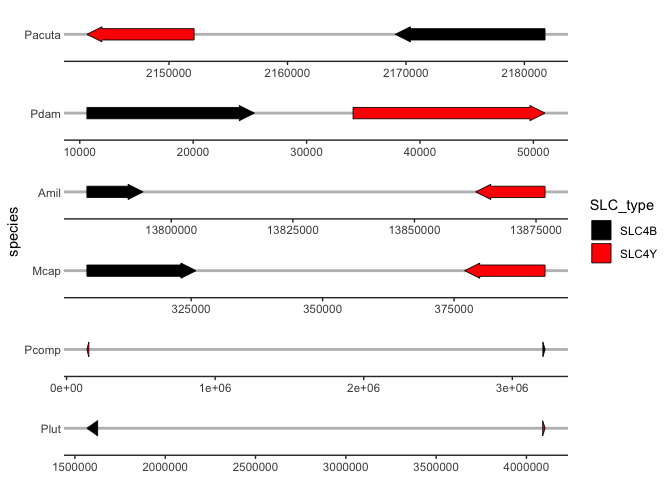
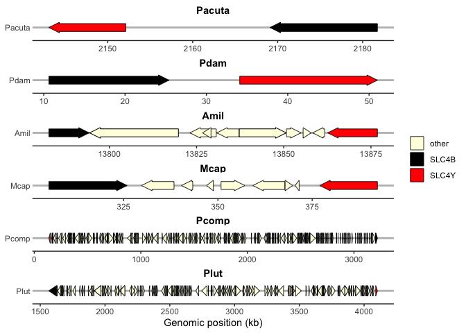
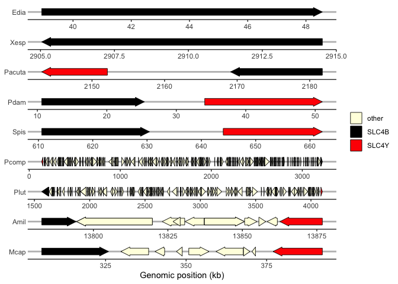

SLC
================
Zoe Dellaert
2026-11-18

## Load packages

``` r
library(tidyverse)
```

    ## Warning: package 'ggplot2' was built under R version 4.5.2

    ## Warning: package 'readr' was built under R version 4.5.2

    ## Warning: package 'purrr' was built under R version 4.5.2

    ## Warning: package 'dplyr' was built under R version 4.5.2

    ## ── Attaching core tidyverse packages ──────────────────────── tidyverse 2.0.0 ──
    ## ✔ dplyr     1.2.1     ✔ readr     2.2.0
    ## ✔ forcats   1.0.1     ✔ stringr   1.6.0
    ## ✔ ggplot2   4.0.3     ✔ tibble    3.3.1
    ## ✔ lubridate 1.9.5     ✔ tidyr     1.3.2
    ## ✔ purrr     1.2.2     
    ## ── Conflicts ────────────────────────────────────────── tidyverse_conflicts() ──
    ## ✖ dplyr::filter() masks stats::filter()
    ## ✖ dplyr::lag()    masks stats::lag()
    ## ℹ Use the conflicted package (<http://conflicted.r-lib.org/>) to force all conflicts to become errors

``` r
library(gggenes)
```

    ## Warning: package 'gggenes' was built under R version 4.5.2

## Step 0

Define species and clades

``` r
species_key <- tribble(
  ~species, ~full_name,       ~genus,   ~clade,
  "Amil", "Acropora_millepora", "Acropora", "complex",
  "Mcap", "Montipora_capitata", "Montipora", "complex",
  "Pcomp", "Porites_compressa", "Porites", "complex",
  "Plut", "Porites_lutea", "Porites", "complex",
  "Pacuta", "Pocillopora_acuta", "Pocillopora", "robust",
  "Pdam",  "Pocillopora_damicornis", "Pocillopora", "robust",
  "Edia", "Exaiptasia_palladia", "Exaiptasia", "outgroup",
  "Xesp",  "Xenia_sp", "Xenia", "outgroup"
) 

species_key <- species_key %>% arrange(desc(clade), species) %>%
  mutate(across(clade, fct_inorder), across(species, fct_inorder))

SLC_colors <- c("SLC4B" = "black", "SLC4Y" = "red", "other"="lightyellow")
```

## Step 1. Load in results from ortholog analyses

``` r
broc_pairs <- data.table::fread("../references/cnidarian_orthologs/broccoli/dir_step4/orthologous_pairs.txt", header=F)
colnames(broc_pairs) <- c("Gene_spA","Gene_spB")

broc_groups <- data.table::fread("../references/cnidarian_orthologs/broccoli/dir_step3/table_OGs_protein_names.txt", header=T)
```

### Download GTFs: many have already been downloaded but code is copied again below as reference:

``` bash
cd references

wget http://cyanophora.rutgers.edu/Pocillopora_acuta/Pocillopora_acuta_HIv2.genes.gff3.gz
wget http://cyanophora.rutgers.edu/montipora/Montipora_capitata_HIv3.genes.gff3.gz
wget http://cyanophora.rutgers.edu/porites_compressa/Porites_compressa_HIv1.genes.gff3.gz

cd cnidarian_marker_genes/cnidarian_sc_marker_lists/annotation_files

wget https://ftp.ncbi.nlm.nih.gov/genomes/all/GCF/013/753/865/GCF_013753865.1_Amil_v2.1/GCF_013753865.1_Amil_v2.1_genomic.gtf.gz
wget https://ftp.ncbi.nlm.nih.gov/genomes/all/GCF/958/299/795/GCF_958299795.1_jaPorLute2.1/GCF_958299795.1_jaPorLute2.1_genomic.gtf.gz
wget https://ftp.ncbi.nlm.nih.gov/genomes/all/GCF/003/704/095/GCF_003704095.1_ASM370409v1/GCF_003704095.1_ASM370409v1_genomic.gtf.gz

gunzip *gz
mv GCF_003704095.1_ASM370409v1_genomic.gtf  07-Pdam_annot.gtf
mv GCF_013753865.1_Amil_v2.1_genomic.gtf    10-Amil_annot.gtf
mv GCF_958299795.1_jaPorLute2.1_genomic.gtf jaPorLute2.1.gtf
```

#### Process GTFs into format for plotting genes

``` r
Pcomp_SwissP <- read.delim("../annotation/Porites_compressa_HIv1_Swissprot_GO.tsv")
Mcap_SwissP <- read.delim("../annotation/Montipora_capitata_HIv3_Swissprot_GO.tsv")
Pacuta_SwissP <- read.delim("../annotation/Pocillopora_acuta_HIv2_Swissprot_GO.tsv")
  
Pacu_gff <- rtracklayer::import("../references/Pocillopora_acuta_HIv2.genes.gff3")
Pacu_annot <- as.data.frame(Pacu_gff) %>%
                        filter(type == "transcript") %>% 
                        select(seqnames, start, end, strand, ID) %>% 
                        distinct() %>% mutate(species = "Pacuta") %>%
  left_join(Pacuta_SwissP %>% select(query,ProteinNames), by = join_by(ID==query))

Pcom_gff <- rtracklayer::import("../references/Porites_compressa_HIv1.genes.gff3")
Pcom_annot <- as.data.frame(Pcom_gff) %>%
                        filter(type == "transcript") %>% 
                        select(seqnames, start, end, strand, ID) %>% 
                        distinct() %>% mutate(species = "Pcomp") %>%
  left_join(Pcomp_SwissP %>% select(query,ProteinNames), by = join_by(ID==query))


Mcap_gff <- rtracklayer::import("../references/Montipora_capitata_HIv3.genes.gff3")
Mcap_annot <- as.data.frame(Mcap_gff) %>%
                        filter(type == "transcript") %>% 
                        select(seqnames, start, end, strand, ID) %>% 
                        distinct() %>% mutate(species = "Mcap") %>%
  left_join(Mcap_SwissP %>% select(query,ProteinNames), by = join_by(ID==query))
```

``` r
Amil_gtf <- rtracklayer::import("../references/cnidarian_marker_genes/cnidarian_sc_marker_lists/annotation_files/10-Amil_annot.gtf")
# choose widest transcript only, since all are annotating the same protein
Amil_transcripts_max <- as.data.frame(Amil_gtf) %>%
                        filter(type=="transcript") %>% 
                        group_by(gene_id) %>% slice_max(width) %>% pull(transcript_id)
# use those to pull the protein IDs, which are not on the same line as the transcript ids                      
Amil_prot <- as.data.frame(Amil_gtf) %>%
                        filter(type == "CDS") %>% filter(transcript_id %in% Amil_transcripts_max) %>% 
                        select(gene_id, protein_id, product) %>% 
                        distinct()

Amil_annot <- as.data.frame(Amil_gtf) %>%
                        filter(gene_biotype=="protein_coding") %>% 
                        select(seqnames, start, end, strand, gene_id) %>% 
                        distinct() %>% left_join(Amil_prot) %>% rename(ID=protein_id) %>% select(-gene_id) %>% 
  mutate(species = "Amil") %>% rename(ProteinNames=product)
```

    ## Joining with `by = join_by(gene_id)`

``` r
# example gene name prefixes
unique(stringr::str_sub(Amil_annot$ID,1,6))
```

    ## [1] "XP_029" "XP_044" NA

``` r
Plut_gtf <- rtracklayer::import("../references/cnidarian_marker_genes/cnidarian_sc_marker_lists/annotation_files/jaPorLute2.1.gtf")
# choose widest transcript only, since all are annotating the same protein
Plut_transcripts_max <- as.data.frame(Plut_gtf) %>%
                        filter(type=="transcript") %>% 
                        group_by(gene_id) %>% slice_max(width) %>% pull(transcript_id)
# use those to pull the protein IDs, which are not on the same line as the transcript ids                      
Plut_prot <- as.data.frame(Plut_gtf) %>%
                        filter(type == "CDS") %>% filter(transcript_id %in% Plut_transcripts_max) %>% 
                        select(gene_id, protein_id, product) %>% 
                        distinct()

Plut_annot <- as.data.frame(Plut_gtf) %>%
                        filter(gene_biotype=="protein_coding") %>% 
                        select(seqnames, start, end, strand, gene_id) %>% 
                        distinct() %>% left_join(Plut_prot) %>% rename(ID=protein_id) %>% select(-gene_id) %>% 
  mutate(species = "Plut") %>% rename(ProteinNames=product)
```

    ## Joining with `by = join_by(gene_id)`

``` r
# example gene name prefixes
unique(stringr::str_sub(Plut_annot$ID,1,6))
```

    ## [1] "XP_073" NA

``` r
Pdam_gtf <- rtracklayer::import("../references/cnidarian_marker_genes/cnidarian_sc_marker_lists/annotation_files/07-Pdam_annot.gtf")

# choose widest transcript only, since all are annotating the same protein
Pdam_transcripts_max <- as.data.frame(Pdam_gtf) %>%
                        filter(type=="transcript") %>% 
                        group_by(gene_id) %>% slice_max(width) %>% pull(transcript_id)
# use those to pull the protein IDs, which are not on the same line as the transcript ids                      
Pdam_prot <- as.data.frame(Pdam_gtf) %>%
                        filter(type == "CDS") %>% filter(transcript_id %in% Pdam_transcripts_max) %>% 
                        select(gene_id, protein_id, product) %>% 
                        distinct()

Pdam_annot <- as.data.frame(Pdam_gtf) %>%
                        filter(gene_biotype=="protein_coding") %>% 
                        select(seqnames, start, end, strand, gene_id) %>% 
                        distinct() %>% left_join(Pdam_prot) %>% rename(ID=protein_id) %>% select(-gene_id) %>% 
  mutate(species = "Pdam") %>% rename(ProteinNames=product)
```

    ## Joining with `by = join_by(gene_id)`

``` r
# example gene name prefixes
unique(stringr::str_sub(Pdam_annot$ID,1,6))
```

    ## [1] "XP_027" NA       "YP_001"

``` r
gff_list <- list(Pacuta = Pacu_annot,
                  Pcomp = Pcom_annot,
                  Mcap = Mcap_annot,
                  Amil = Amil_annot,
                 Plut = Plut_annot,
                 Pdam = Pdam_annot)

gff_all <- do.call(rbind,gff_list)

gff_all <- gff_all %>% mutate(forward = case_when(
      strand == "+" ~ TRUE, strand == "-" ~ FALSE,
    ))
```

### SLC4 B + Y

> XP_029206541.1 anion exchange protein 2-like \[Acropora millepora
> SLC4Y\] XP_029206496.2 band 3 anion transport protein-like \[Acropora
> millepora SLC4B\]

``` r
Amil_SLC4B <- "XP_029206496.2"
Amil_SLC4Y <- "XP_029206541.1"

SLC4B_broc <- c(broc_pairs %>% filter(grepl(Amil_SLC4B,Gene_spA)) %>% pull(Gene_spB),
                broc_pairs %>% filter(grepl(Amil_SLC4B,Gene_spB)) %>% pull(Gene_spA),
                Amil_SLC4B)

SLC4Y_broc <- c(broc_pairs %>% filter(grepl(Amil_SLC4Y,Gene_spA)) %>% pull(Gene_spB),
                broc_pairs %>% filter(grepl(Amil_SLC4Y,Gene_spB)) %>% pull(Gene_spA),
                Amil_SLC4Y)

SLC4B_broc_group <- broc_groups %>% filter(grepl(Amil_SLC4B,Amil_proteins.faa))
SLC4Y_broc_group <- broc_groups %>% filter(grepl(Amil_SLC4Y,Amil_proteins.faa))
print(t(SLC4B_broc_group))
```

    ##                      [,1]                                                                                                                                                
    ## #OG_name             "OG_15787"                                                                                                                                          
    ## Acer_proteins.faa    "ENSLGJP00010037021.1 ENSLGJP00010037034.1 ENSLGJP00010037039.1 ENSLGJP00010037047.1 ENSLGJP00010037051.1 ENSLGJP00010038608.1 ENSLGJP00010038617.1"
    ## Ahya_proteins.faa    "ENSATYP00010027930.1 ENSATYP00010027936.1 ENSATYP00010029228.1"                                                                                    
    ## Amil_proteins.faa    "XP_029206496.2 XP_029206541.1 XP_029206545.1 XP_029206546.1"                                                                                       
    ## Amur_proteins.faa    "XP_067019178.1 XP_067019179.1 XP_067019180.1 XP_067019838.1"                                                                                       
    ## Apoc_proteins.faa    "protein|evm.model.Ap11.79 protein|evm.model.Ap11.81"                                                                                               
    ## Edia_proteins.faa    "AIPGENE21648"                                                                                                                                      
    ## Hsym_proteins.faa    "XP_057305087.1 XP_057305088.1"                                                                                                                     
    ## Hvul_proteins.faa    "Sc4wPfr_301.g13988.t1 Sc4wPfr_301.g13990.t1"                                                                                                       
    ## McapASG_proteins.faa "ENSOPAP00000025196.1 ENSOPAP00000030688.1"                                                                                                         
    ## Mcap_proteins.faa    "Montipora_capitata_HIv3___RNAseq.g44456.t1 Montipora_capitata_HIv3___RNAseq.20936_t"                                                               
    ## Nvec_proteins.faa    "NV2t011174001.1"                                                                                                                                   
    ## Ofav_proteins.faa    "QW917_034175-T1 QW917_034176-T1"                                                                                                                   
    ## Pacu_proteins.faa    "Pocillopora_acuta_HIv2___TS.g27873.t1 Pocillopora_acuta_HIv2___RNAseq.g15280.t1"                                                                   
    ## Pcom_proteins.faa    "Porites_compressa_HIv1___RNAseq.g31477.t1 Porites_compressa_HIv1___RNAseq.g31687.t1"                                                               
    ## PdamASG_proteins.faa "XP_027035732.2 XP_027035733.2 XP_089049830.1 XP_089049831.1 XP_089049832.1"                                                                        
    ## Pdam_RG_proteins.faa "pdam_00022877-RA pdam_00022876-RA"                                                                                                                 
    ## Pdam_proteins.faa    "XP_027035732.1 XP_027035733.1"                                                                                                                     
    ## Plob_proteins.faa    "ENSNQRP00000018228.1 ENSNQRP00000018238.1 ENSNQRP00000020142.1 ENSNQRP00000020146.1 ENSNQRP00000020155.1 ENSNQRP00000032552.1 ENSNQRP00000032558.1"
    ## Plut_proteins.faa    "ENSXVXP00000019077.1 ENSXVXP00000019082.1 ENSXVXP00000019091.1 ENSXVXP00000021256.1"                                                               
    ## Spis_proteins.faa    "XP_022788270.1 XP_022788307.1 XP_022788308.1 XP_022788309.1 XP_022788310.1 XP_022788311.1"                                                         
    ## Xesp_proteins.faa    "Xe_021526-T1"

``` r
print(t(SLC4Y_broc_group))
```

    ##                      [,1]                                                                                                                                                
    ## #OG_name             "OG_15787"                                                                                                                                          
    ## Acer_proteins.faa    "ENSLGJP00010037021.1 ENSLGJP00010037034.1 ENSLGJP00010037039.1 ENSLGJP00010037047.1 ENSLGJP00010037051.1 ENSLGJP00010038608.1 ENSLGJP00010038617.1"
    ## Ahya_proteins.faa    "ENSATYP00010027930.1 ENSATYP00010027936.1 ENSATYP00010029228.1"                                                                                    
    ## Amil_proteins.faa    "XP_029206496.2 XP_029206541.1 XP_029206545.1 XP_029206546.1"                                                                                       
    ## Amur_proteins.faa    "XP_067019178.1 XP_067019179.1 XP_067019180.1 XP_067019838.1"                                                                                       
    ## Apoc_proteins.faa    "protein|evm.model.Ap11.79 protein|evm.model.Ap11.81"                                                                                               
    ## Edia_proteins.faa    "AIPGENE21648"                                                                                                                                      
    ## Hsym_proteins.faa    "XP_057305087.1 XP_057305088.1"                                                                                                                     
    ## Hvul_proteins.faa    "Sc4wPfr_301.g13988.t1 Sc4wPfr_301.g13990.t1"                                                                                                       
    ## McapASG_proteins.faa "ENSOPAP00000025196.1 ENSOPAP00000030688.1"                                                                                                         
    ## Mcap_proteins.faa    "Montipora_capitata_HIv3___RNAseq.g44456.t1 Montipora_capitata_HIv3___RNAseq.20936_t"                                                               
    ## Nvec_proteins.faa    "NV2t011174001.1"                                                                                                                                   
    ## Ofav_proteins.faa    "QW917_034175-T1 QW917_034176-T1"                                                                                                                   
    ## Pacu_proteins.faa    "Pocillopora_acuta_HIv2___TS.g27873.t1 Pocillopora_acuta_HIv2___RNAseq.g15280.t1"                                                                   
    ## Pcom_proteins.faa    "Porites_compressa_HIv1___RNAseq.g31477.t1 Porites_compressa_HIv1___RNAseq.g31687.t1"                                                               
    ## PdamASG_proteins.faa "XP_027035732.2 XP_027035733.2 XP_089049830.1 XP_089049831.1 XP_089049832.1"                                                                        
    ## Pdam_RG_proteins.faa "pdam_00022877-RA pdam_00022876-RA"                                                                                                                 
    ## Pdam_proteins.faa    "XP_027035732.1 XP_027035733.1"                                                                                                                     
    ## Plob_proteins.faa    "ENSNQRP00000018228.1 ENSNQRP00000018238.1 ENSNQRP00000020142.1 ENSNQRP00000020146.1 ENSNQRP00000020155.1 ENSNQRP00000032552.1 ENSNQRP00000032558.1"
    ## Plut_proteins.faa    "ENSXVXP00000019077.1 ENSXVXP00000019082.1 ENSXVXP00000019091.1 ENSXVXP00000021256.1"                                                               
    ## Spis_proteins.faa    "XP_022788270.1 XP_022788307.1 XP_022788308.1 XP_022788309.1 XP_022788310.1 XP_022788311.1"                                                         
    ## Xesp_proteins.faa    "Xe_021526-T1"

``` r
SLC4B_broc_sel <- as.data.frame(SLC4B_broc) %>%
  # find rows that contain genes from our three species and label them with a new species column
  mutate(
    species = case_when(
      grepl(Amil_SLC4B, SLC4B_broc) ~ "Amil",
      grepl("Pocillopora_acuta", SLC4B_broc) ~ "Pacuta",
      grepl("Montipora_capitata", SLC4B_broc) ~ "Mcap",
      grepl("Porites_compressa", SLC4B_broc) ~ "Pcomp",
      grepl("ENSXVXP", SLC4B_broc) ~ "Plut",
      grepl("XP_027|YP_001", SLC4B_broc) ~ "Pdam"
    )
  ) %>%
  # remove rows that don't contain genes from our three species
  filter(!is.na(species)) %>%
  select(SLC4B_broc, species) %>% mutate(SLC_type = "SLC4B") %>% rename(SLC4_gene=SLC4B_broc)

SLC4Y_broc_sel <- as.data.frame(SLC4Y_broc) %>%
  # find rows that contain genes from our three species and label them with a new species column
  mutate(
    species = case_when(
      grepl(Amil_SLC4Y, SLC4Y_broc) ~ "Amil",
      grepl("Pocillopora_acuta", SLC4Y_broc) ~ "Pacuta",
      grepl("Montipora_capitata", SLC4Y_broc) ~ "Mcap",
      grepl("Porites_compressa", SLC4Y_broc) ~ "Pcomp",
      grepl("ENSXVXP", SLC4Y_broc) ~ "Plut",
      grepl("XP_027|YP_001", SLC4Y_broc) ~ "Pdam"
    )
  ) %>%
  # remove rows that don't contain genes from our three species
  filter(!is.na(species)) %>%
  select(SLC4Y_broc, species) %>% mutate(SLC_type = "SLC4Y") %>% rename(SLC4_gene=SLC4Y_broc)
```

#### Modify SLC gene IDs for cases where the GTF IDs don’t exactly match the protein FASTA (used in broccoli) IDs

P damicornis:

``` r
#> grep("XP_027|YP_001", SLC4B_broc, value = T)
#[1] "XP_027035732.2" "XP_027035732.1"
#> grep("XP_027|YP_001", SLC4Y_broc, value = T)
#[1] "XP_027035733.2" "XP_027035733.1"

# looked these up on NCBI

SLC4B_broc_sel <- SLC4B_broc_sel %>% mutate(SLC4_gene=ifelse(
  species =="Pdam",
  str_replace(SLC4_gene,"\\.2","\\.1"),
  SLC4_gene)) %>% distinct()

SLC4Y_broc_sel <- SLC4Y_broc_sel %>% mutate(SLC4_gene=ifelse(
  species =="Pdam",
  str_replace(SLC4_gene,"\\.2","\\.1"),
  SLC4_gene)) %>% distinct()
```

P lutea:

``` r
#> grep("ENSXVXP", SLC4B_broc, value = T)
#[1] "ENSXVXP00000019077.1" "ENSXVXP00000019082.1" "ENSXVXP00000019091.1"
#> grep("ENSXVXP", SLC4Y_broc, value = T)
#[1] "ENSXVXP00000021256.1"

# looked these up on NCBI

Plut_SLC4B <- "XP_073230193.1" #"LOC140924093"
Plut_SLC4Y <- "XP_073229999.1" #"LOC140923879"

SLC4B_broc_sel <- SLC4B_broc_sel %>% mutate(SLC4_gene=ifelse(species =="Plut", Plut_SLC4B,SLC4_gene)) %>% distinct()
SLC4Y_broc_sel <- SLC4Y_broc_sel %>% mutate(SLC4_gene=ifelse(species =="Plut", Plut_SLC4Y,SLC4_gene)) %>% distinct()
```

#### combine SLC lookups with gffs

``` r
# two ways to get the same information, might be relevant later
gff_SLC <- gff_all %>% filter(grepl(paste(SLC4B_broc_sel$SLC4_gene,collapse = "|"), ID)|
                                grepl(paste(SLC4Y_broc_sel$SLC4_gene,collapse = "|"), ID))

SLCs_sel <- rbind(SLC4B_broc_sel,SLC4Y_broc_sel) %>%
  left_join(gff_all,by=join_by(SLC4_gene==ID, species==species)) %>%
  left_join(species_key) %>% arrange(clade, species) %>%
  mutate(across(species, fct_inorder))
```

    ## Joining with `by = join_by(species)`

``` r
ggplot(SLCs_sel, aes(xmin = start, xmax = end, y = species, fill = SLC_type, forward=forward)) +
  geom_gene_arrow() +
  facet_wrap(~ species, scales = "free", ncol = 1) +
  scale_fill_manual(values = SLC_colors) + theme_genes()
```

<!-- -->

``` r
pad <- 100

windows <- SLCs_sel %>%
  group_by(species, seqnames) %>%
  summarise(lo = min(start) - pad, hi = max(end) + pad, .groups = "drop")

betweens <- gff_all %>%
  inner_join(windows, by = c("seqnames", "species")) %>%
  filter(end >= lo, start <= hi) %>% 
  filter(!(ID %in% SLCs_sel$SLC4_gene)) %>% mutate(SLC_type = "other") %>%
  left_join(species_key) %>% arrange(clade, species) %>%
  mutate(across(species, fct_inorder))
```

    ## Joining with `by = join_by(species)`

``` r
gaps <- SLCs_sel %>%
  arrange(species, start) %>%
  group_by(species) %>%
  summarise(seqnames = paste0(unique(seqnames),collapse = ";"), gap_start = first(end), gap_end = last(start),
            .groups = "drop") %>%
  mutate(gap_bp = gap_end - gap_start)

gap_summary <- gaps %>%
  left_join(betweens %>% count(species, name = "genes_between"), by = "species") %>%
  mutate(genes_between = replace_na(genes_between, 0L))

print(gap_summary)
```

    ## # A tibble: 6 × 6
    ##   species seqnames                        gap_start gap_end gap_bp genes_between
    ##   <fct>   <chr>                               <int>   <int>  <int>         <int>
    ## 1 Pacuta  Pocillopora_acuta_HIv2___Sc000…   2152118  2.17e6 1.70e4             0
    ## 2 Pdam    NW_020843986.1                      25403  3.41e4 8.69e3             0
    ## 3 Amil    NC_058076.1                      13794215  1.39e7 6.84e4            10
    ## 4 Mcap    Montipora_capitata_HIv3___Scaf…    325925  3.77e5 5.11e4             7
    ## 5 Pcomp   Porites_compressa_HIv1___Sc000…    149754  3.21e6 3.06e6           232
    ## 6 Plut    NC_133214.1                       1625810  4.09e6 2.46e6           164

``` r
write.csv(SLCs_sel, "../annotation/biomineralization/SLC_mapping/SLC_genes.csv")
write.csv(betweens, "../annotation/biomineralization/SLC_mapping/between_genes.csv")
```

``` r
plot_df <- bind_rows(betweens , SLCs_sel) %>% mutate(
    start_kb = start / 1e3,
    end_kb = end / 1e3
  ) %>%
  left_join(species_key) %>% arrange(clade, species) %>%
  mutate(across(species, fct_inorder))
```

    ## Joining with `by = join_by(species, full_name, genus, clade)`

``` r
ggplot(plot_df, aes(xmin = start_kb, xmax = end_kb, y = species, fill = SLC_type, forward=forward)) +
  geom_gene_arrow() +
  facet_wrap(~ species, scales = "free", ncol = 1) +
  scale_fill_manual(values = SLC_colors)  + theme_genes() +
  labs(x = "Genomic position (kb)", y = NULL, fill = NULL)  + theme(strip.text = element_text(face = "bold"))
```

<!-- -->

``` r
#reverse Pacuta coordinates to be in same orientation as the others -- all the others have SLC4B as + strand

Pacu_gap <- gaps %>% filter(species=="Pacuta") %>% pull(gap_bp)
Pacu_SLC4B_width <- SLCs_sel %>% mutate(width = end-start)  %>% filter(species=="Pacuta" & SLC_type=="SLC4B" ) %>% pull(width)
Pacu_SLC4Y_start <- Pacu_SLC4B_width + Pacu_gap

SLCs_sel_mod <- SLCs_sel %>%
  mutate(width = end-start, 
         start_mod = ifelse(species=="Pacuta" & SLC_type=="SLC4B",0,start),
         end_mod   = ifelse(species=="Pacuta" & SLC_type=="SLC4B",start_mod+width,end)) %>%
  mutate(start_mod = ifelse(species=="Pacuta" & SLC_type=="SLC4Y",
                            Pacu_SLC4Y_start,start_mod),
         end_mod   = ifelse(species=="Pacuta" & SLC_type=="SLC4Y",Pacu_SLC4Y_start+width,end_mod)) %>% 
  mutate(forward = ifelse(species=="Pacuta", TRUE, forward)) %>% select(-c(start,end)) %>%
  rename(start = start_mod, end = end_mod)

plot_df <- bind_rows(betweens , SLCs_sel_mod) %>% 
  group_by(seqnames) %>%
  mutate(SLC_start_coord = start[SLC_type %in% "SLC4B"][1]) %>% ungroup() %>%
  mutate(
    start_kb = abs((start - SLC_start_coord) / 1e3),
    end_kb = abs((end - SLC_start_coord) / 1e3)
  ) %>%
  left_join(species_key) %>% arrange(clade, species) %>%
  mutate(across(species, fct_inorder))
```

    ## Joining with `by = join_by(species, full_name, genus, clade)`

``` r
ggplot(plot_df, aes(xmin = start_kb, xmax = end_kb, y = species, fill = SLC_type, forward=forward)) +
  geom_gene_arrow() +
  facet_wrap(~ genus, scales = "free", ncol = 1) +
  scale_fill_manual(values = SLC_colors)  + theme_genes() +
  labs(x = "Relative Genomic position (kb)", y = NULL, fill = "SLC_gene")  + theme(strip.text = element_text(face = "bold"))
```

<!-- -->

### Nicest version without porites

``` r
# plot_df <- plot_df %>% filter(genus != "Porites") %>%
#   mutate(shortname = case_when(
#     SLC_type != "other" ~SLC_type,
#     SLC_type == "other"~ sub(" \\(.*", "", ProteinNames)
#   )) %>%
#   mutate(shortname = replace_na(shortname, "unnanot."))

plot_df_new <- plot_df %>% filter(genus != "Porites") %>% mutate(
    base = str_remove(ProteinNames, " \\(.*"),
    shortname = case_when(
      SLC_type != "other" ~ SLC_type,
      TRUE ~ base %>%
        str_remove(" isoform X?\\d+$") %>%
        str_remove("^uncharacterized protein ") %>%
        str_remove("-like$") %>%
        str_replace_all(c(
          "voltage-dependent L-type calcium channel subunit beta-2" = "L-type Ca Channel",
          "26S proteasome non-ATPase regulatory subunit 7"          = "26S proteasome",
          "mitogen-activated protein kinase kinase kinase 3"        = "MAP_kinase_3",
          "lipopolysaccharide-induced tumor necrosis factor-alpha factor homolog" = "TNF",
          "Heat shock cognate 71 kDa protein"                       = "HSP70",
          "SH3 domain-containing protein Dlish"                     = "Dlish",
          "Protein FAM133B"                                         = "FAM133B",
          "DnaJ homolog subfamily C member 27"                      = "DnaJ_C27",
          "DnaJ homolog subfamily C member 22"                      = "DnaJ_C22",
          "Peroxisome assembly protein 12"                          = "Peroxisome assembly protein",
          "apolipoprotein L3"                                       = "Apolipoprotein L3"
        )) %>% replace_na("unnanot.")
    )
  ) %>%
  select(-base) %>% select(clade, species, start_kb,end_kb, SLC_type, forward, shortname) %>% distinct()

ggplot(plot_df_new, aes(xmin = start_kb, xmax = end_kb, y = species, fill = SLC_type, forward=forward)) +
  geom_gene_arrow(arrowhead_height = unit(3, "mm"), arrowhead_width = unit(1, "mm")) +
# geom_text(aes(x = (start_kb+end_kb)/2, label=shortname), nudge_y = 0.15, size = 2.8, angle = 30, hjust = 0, check_overlap = TRUE) +
  ggrepel::geom_text_repel(aes(x = (start_kb + end_kb) / 2, label = shortname), direction = "both", nudge_y = 0.25,force_pull =.5,  size = 3,max.overlaps = Inf) +
  facet_wrap(~ clade, scales = "free_y", ncol = 1) +
  scale_fill_manual(values = SLC_colors)  + theme_genes() +
  labs(x = "Relative Genomic position (kb)", y = NULL, fill = "SLC_gene")  + theme(strip.text = element_text(face = "bold"))
```

<!-- -->
